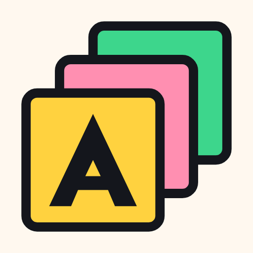

# Adrien



[](https://github.com/moumine9/adrien/actions/workflows/ci.yml)
[](https://www.npmjs.com/package/adrien)
[](https://nodejs.org/)
[](LICENSE)
[](https://moumine9.github.io/adrien/docs/)

Architecture decisions for developers **and their AI agents**. (Yes, the name is a nod to ADR.)

Decisions get made in merge-request threads, chat and tickets, and then they are lost. Nobody has an overview, nothing
gets updated, and AI coding agents never see the _why_ behind the code, so they happily "fix" something that was written
that way on purpose.

Adrien keeps your Architecture Decision Records (ADRs) as plain markdown in your own git repos and answers one question
for people and agents alike: **which decisions govern the code I am about to change, and why?**

- **Plain files, no lock-in.** ADRs are markdown with a little frontmatter. Plain MADR, log4brains and adr-tools files
  are read as they are.
- **Many repos, one log per product.** A product can span many repos (microservices, micro-frontends). Its decisions
  live in one log, and each ADR names the files it governs. A product log can name a common log in its `common` field, whose accepted decisions bind the product too.
- **The merge request is the approval.** A decision is binding only once it is `accepted` on the default branch.
  Agents and developers can propose; architects approve by merging.
- **Built for agents.** An MCP server hands an agent the governing decisions and their one-line `review_rule` before it
  edits, and lets it propose new ones. It can never accept anything itself.
- **Informs, never blocks.** `adrien check` is CI-ready, and flags problems rather than gating your pipeline.

## Install

Needs Node 22.13 or later.

```sh
npx adrien --help        # or: npm install -g adrien
```

## Quickstart

**1. Create the log**, in the repo that will hold your decisions (or inside a monorepo):

```sh
adrien init --product acme
adrien new "Store invoices in Postgres" --tags backend,database
adrien check
```

`init` prints the two things to set up on your git host: `CODEOWNERS` for the ADR folder, and required code-owner
approval on the default branch.

**2. Link each code repo** to the log, and tell agents about it:

```sh
adrien init --code-repo --log ../decisions     # or a git URL
adrien init --agents                           # adds a block to AGENTS.md
```

**3. Ask what governs a file:**

```sh
adrien for src/Invoices/Invoice.ts
```

```text
src/Invoices/Invoice.ts [billing-service]
  ADR-0007 BINDING Store invoices in Postgres
    rule: Invoices are read and written through the repository, never the document client.
```

**4. Approve by merging.** `adrien accept ADR-0007`, commit, and merge the merge request.

## Use it from an AI agent

```sh
claude mcp add adrien -- npx -y adrien mcp
```

Run from the code repo (or log repo). Any MCP client that speaks stdio works the same way. The agent gets six tools:
`adr_for_files`, `adr_search`, `adr_list`, `adr_get`, `adr_propose` and `adr_propose_change`.

## Commands

`init`, `new`, `list`, `show`, `search`, `for`, `review`, `check`, `lint`, `export`, `accept`, `status`, `supersede`, `renumber`, `rename-workspace`, `sync`, `update`, `backup`, `mcp`, `serve`.
Run `adrien <command> --help`. Add `--json` for machine-readable output. `adrien update --check` compares your version with the latest on npm; `adrien update` installs it when adrien is a global install (other installs get the command to run), after backing up the decision files (see `adrien backup` in the format reference). `adrien serve` starts a read-only
[local HTTP API](https://github.com/moumine9/adrien/blob/main/docs/api.md) on `127.0.0.1:4310`. To run it for a team, see
[self-hosting](https://github.com/moumine9/adrien/blob/main/docs/self-hosting.md).

## Documentation

The [format reference](https://github.com/moumine9/adrien/blob/main/docs/format.md) covers the ADR format, the config
files, anchors, and how approval works.

Adrien keeps its own architecture decisions in
[`docs/decisions`](https://github.com/moumine9/adrien/tree/main/docs/decisions), and its CI runs `adrien check` on them.

## Status

Early. What exists today: the format, the CLI, the MCP server, and `adrien serve`, a read-only HTTP API that also
serves a web visualizer and can be self-hosted for a team.

## License

[AGPL-3.0](LICENSE)
